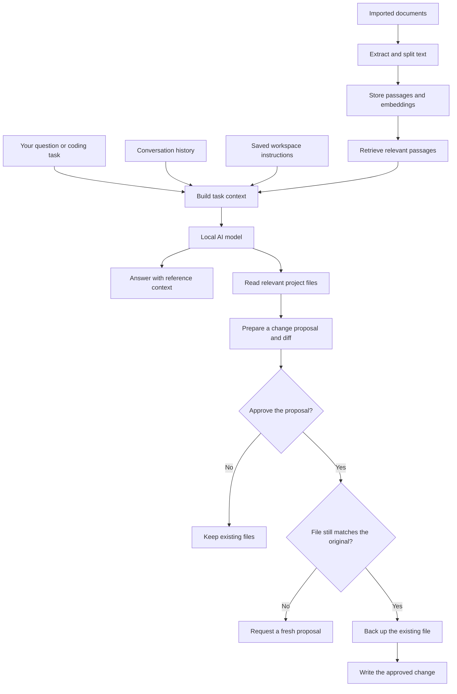

<div align="center">

# Shakti AI Agent

**A local AI workspace for code, documents, and persistent memory.**

Python 3.10+ · Local inference · Backend milestone · Desktop in development

[Get started](#get-started) · [Capabilities](#published-capabilities) · [Architecture](#how-it-works) · [Roadmap](#roadmap)

</div>

---

Shakti is being built as a Windows desktop assistant that helps you understand
code, propose fixes, and work with your own reference material. Its backend
connects to AI models running on your computer and stores conversation history,
explicit memories, and indexed documents locally.

> **Current public release:** the backend foundation and its tests. The desktop
> interface, mascots, launcher, and setup scripts are being developed locally
> and will be published in later milestones. This repository does not yet provide
> an installable desktop application.

## Published capabilities

| Area | Available in this milestone |
| --- | --- |
| Local AI connection | Chat and streamed responses through a loopback-only local AI endpoint |
| Persistent memory | SQLite storage for conversations, explicit notes, and document chunks, separated by scope |
| Document extraction | Text-based PDF, DOCX, XLSX, UTF-8 text, CSV, and supported source files |
| Document retrieval | Chunking, embedding-based search, and source references in model context |
| Coding workflow | A bounded loop that reads files and proposes complete replacements for review |
| Reviewed writes | Diffs, stale-file detection, and backups of existing files before applying changes |
| Workspace boundaries | Project-relative paths; hidden, credential, runtime, and linked paths excluded |

These are backend APIs. A graphical workflow for using them is not included in
this public milestone.

## Get started

### Requirements

- Python **3.10 or later**; development currently targets Windows.
- Git to clone the repository.
- A compatible local AI runtime and downloaded weights **only for live AI use**.

### Install and test

Run these commands in PowerShell:

```powershell
git clone https://github.com/akshau094/Shakti-AI-Agent.git
cd Shakti-AI-Agent
python -m venv .venv
.\.venv\Scripts\python.exe -m pip install -r requirements-core.txt
.\.venv\Scripts\python.exe -m unittest discover -s tests -p test_core.py -v
```

The eight backend tests use a fake model provider and temporary files. They
exercise memory, document indexing, retrieval, file boundaries, reviewed writes,
and the agent loop without downloading weights or calling an AI service.

### Connect a local model

Live AI use requires a compatible local runtime listening at
`http://127.0.0.1:11434`, plus downloaded coding and document-embedding weights.
The backend currently expects `qwen2.5-coder:1.5b` for answers and
`nomic-embed-text` for document embeddings.

Runtime setup and download commands are not included in this backend milestone.
The planned desktop setup flow will handle those steps. The tests above can be
run independently of a live AI installation.

Initial downloads require internet access. Once configured, inference requests
use the local endpoint and bypass system HTTP proxies.

Check the connection from the repository root:

```powershell
.\.venv\Scripts\python.exe -c "from shakti.core import LocalModel; print(LocalModel().models())"
```

This is a library connection check, not a desktop launch command. Model quality
and response speed depend on the selected weights, task, and available hardware.

## How it works

Shakti combines your request with relevant local context, asks a model running
on your computer, and returns an answer or a file-change proposal.



### Questions and document context

1. **Import:** readable text is extracted from supported documents and split into passages.
2. **Index:** passages, source references, and embeddings are stored in the local database. Content hashes avoid reindexing unchanged documents.
3. **Retrieve:** relevant passages are selected for a question using embedding similarity.
4. **Answer:** retrieved context, saved instructions, and recent conversation history are supplied to the local model.

Documents and explicit memories are separated by workspace scope. They provide
reference context; importing a document or saving a conversation does not train
the model's weights.

### Coding and reviewed changes

The coding loop can inspect project files and prepare complete replacement
content with a diff. Proposing a change does not write it to disk. When the
caller approves and applies a proposal, Shakti checks that the original file
has not changed and backs up existing content before writing.

The published backend provides the proposal and apply APIs; the review interface
is part of the upcoming desktop milestone. The agent loop has a ten-step limit
and cannot execute shell commands.

## Repository layout

The public repository currently contains the backend milestone:

```text
Shakti-AI-Agent/
├── shakti/
│   ├── __init__.py          Package entry point
│   └── core.py              Local AI, memory, documents, and coding workflow
├── tests/
│   └── test_core.py         Backend behavior and file-boundary checks
├── .gitignore               Excludes local data, runtimes, weights, and secrets
├── requirements-core.txt    Dependencies for document extraction
└── README.md                Setup, architecture, status, and roadmap
```

### Inside the backend

| Component in `shakti/core.py` | Responsibility |
| --- | --- |
| `LocalModel` | Connects to the local inference endpoint for chat, streaming, and embeddings |
| `Store` | Persists scoped conversations, explicit memories, documents, and passage vectors in SQLite |
| `extract()` | Reads supported document and source-file formats within import limits |
| `ingest()` / `retrieve()` | Builds the document index and selects passages relevant to a question |
| `Workspace` | Enforces project file boundaries, creates diffs, and applies reviewed changes with backups |
| `answer()` | Combines retrieved context, memory, and conversation history for a response |
| `code_agent()` | Coordinates the bounded read, propose, and finish workflow |

### Local files excluded from uploads

Conversations, document indexes, and file backups are stored under `data/`.
Downloaded runtimes and model weights used by the local development setup are
kept under `runtime/`. Both directories are excluded from Git, alongside virtual
environments and credential-file patterns. Runtime or model files configured
outside the project remain in their separately configured locations.

The desktop interface and additional integration files are not included in this
public milestone; their planned publication is tracked in the roadmap below.

## Current limits

- Imports are limited to 20 MB per file and two million extracted characters.
- Scanned PDFs, images, audio, and video require OCR or transcription that is
  not included in this milestone.
- Coding tools work with text files up to 100 KB and have a ten-step agent limit.
- Proposed changes require review; model output can contain mistakes.
- Automatic training and self-improvement are not implemented in this release.
- OpenJarvis integration is under evaluation and is not part of this milestone.

## Roadmap

- [x] Local inference connection and streaming
- [x] Scoped conversation and explicit-memory storage
- [x] Document extraction, indexing, and retrieval
- [x] Reviewed file proposals and backend tests
- [ ] Publish the white desktop workspace and pixel mascots
- [ ] Publish local model setup, readiness checks, and launch scripts
- [ ] Publish real-model acceptance checks
- [ ] Evaluate stronger document processing and agent integrations
- [ ] Develop and evaluate a controlled learning workflow

The project is published in meaningful increments as development progresses.
Checked items refer to capabilities present in this repository; unchecked items
are not promises of a completed release.

## Feedback

Use [GitHub Issues](https://github.com/akshau094/Shakti-AI-Agent/issues) to report
bugs or suggest improvements. Include the steps to reproduce, Python version,
and a sanitised error message. Keep private documents, credentials, and personal
conversation history out of public reports.
